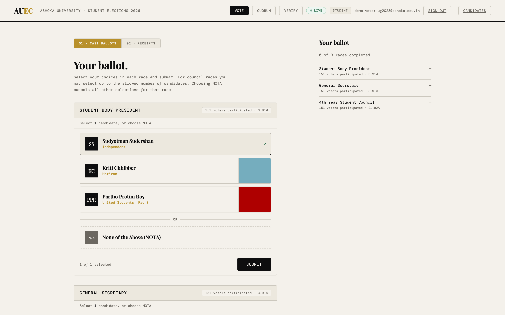
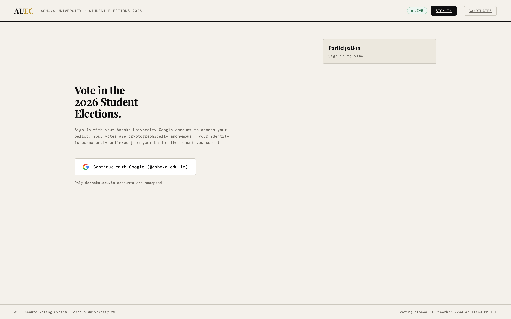
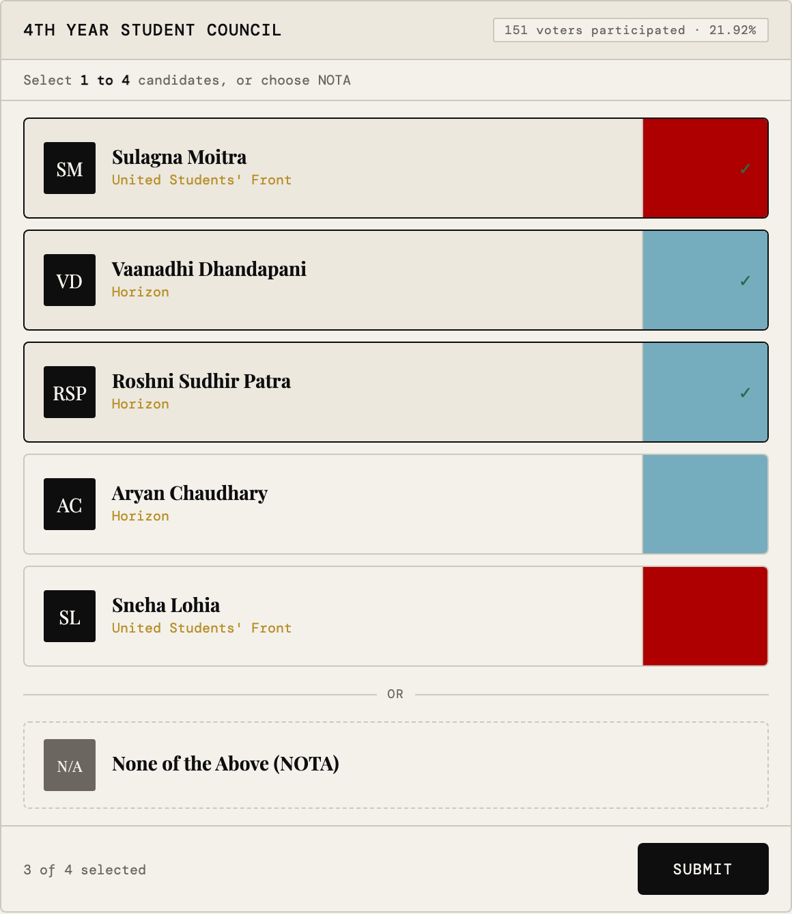
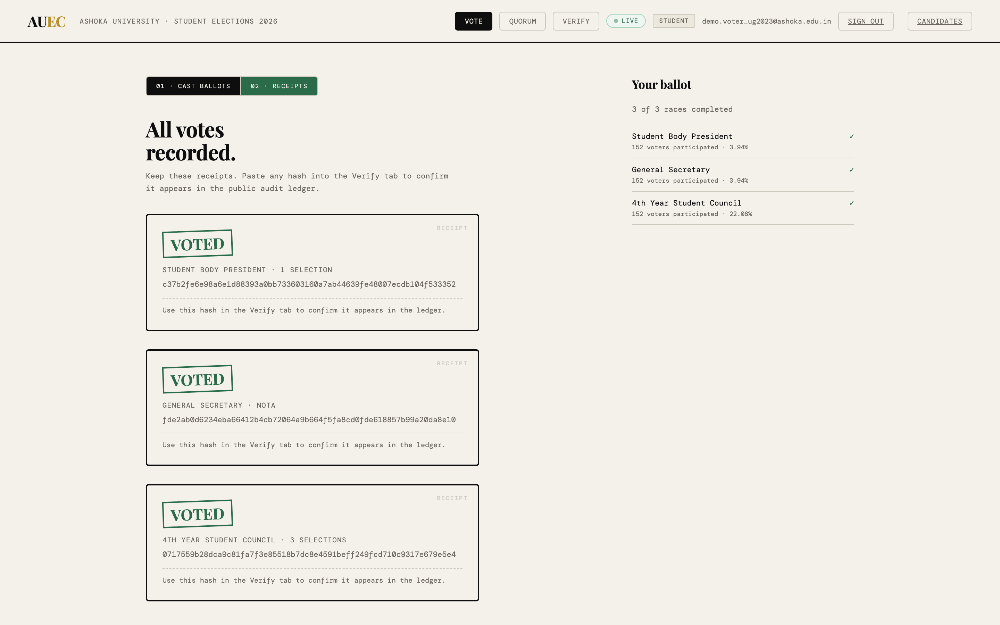
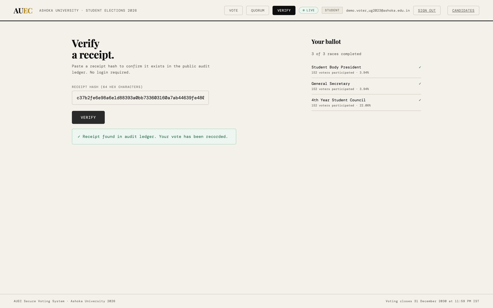
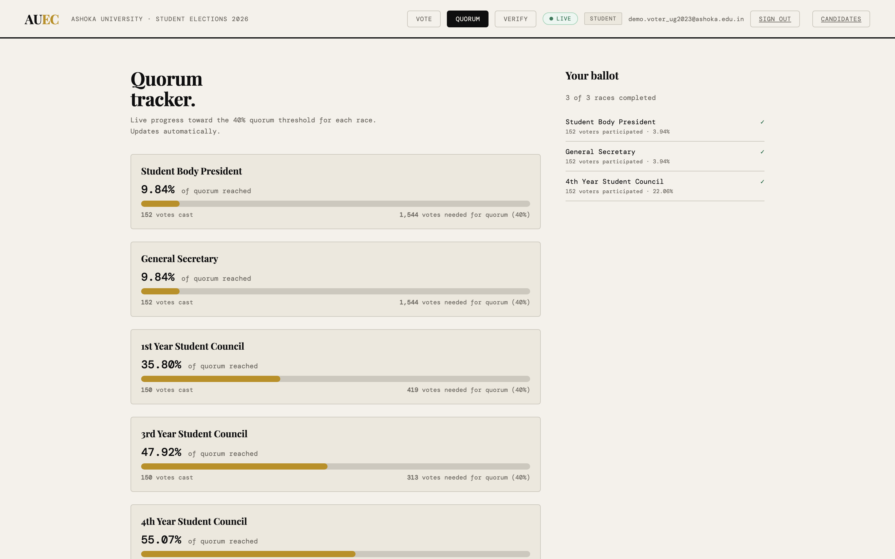
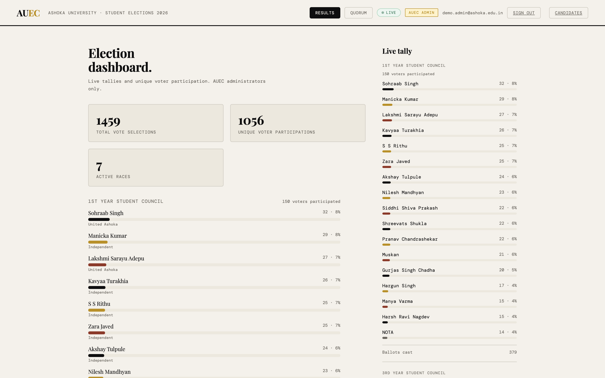
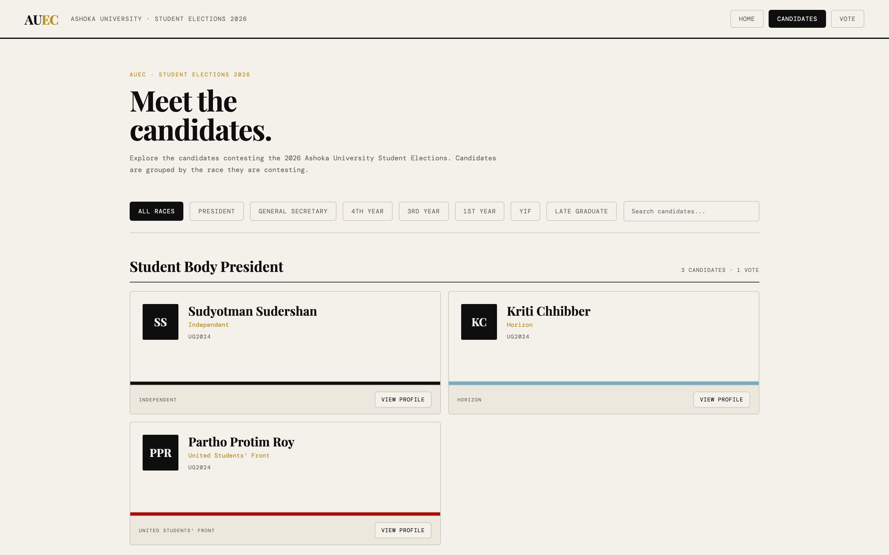
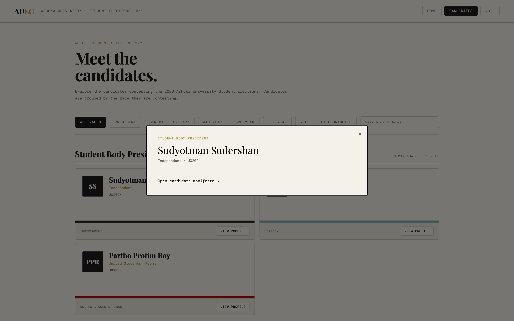
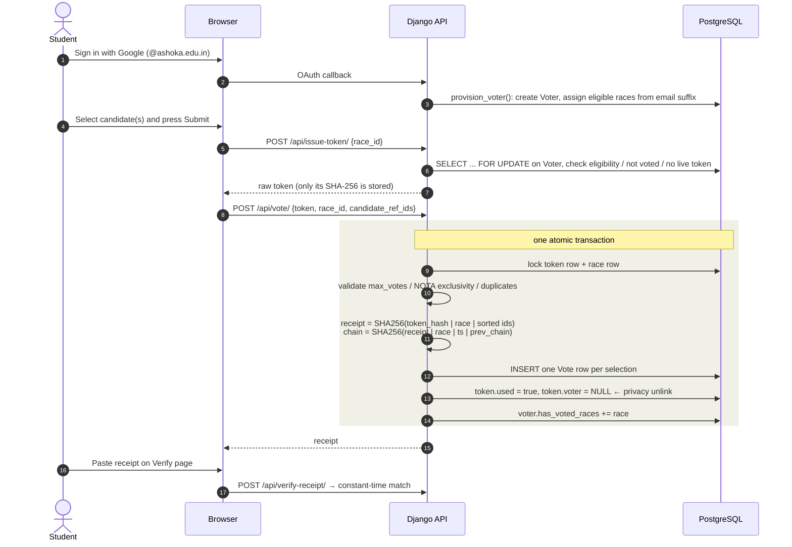

<div align="center">

# AUEC Secure Voting Portal

**An anonymous, auditable online voting system built for the Ashoka University Election Commission's 2026 student elections.**

Students sign in with their university Google account, vote in the races their batch is eligible for, and get a cryptographic receipt they can check against a public audit ledger. Once a ballot is cast, the system deletes the link between the voter and their vote.


**Used in production for the 2026 AUEC student elections.** The hosted Railway instance has since been taken down, so the screenshots below are from a local run.



</div>

---

## Why I built this

Paper ballots for a ~3,900-student electorate are slow to count, and earlier online forms couldn't answer two questions together: **"Did my vote count?"** and **"Can anyone see who I voted for?"**

This portal answers both:

- **Anonymity by design.** A single-use voting token is issued per race. When the ballot is submitted, the token's link to the voter is set to `NULL` in the same database transaction. After that, nothing in the system connects a person to their choices. Even database admins can't see it.
- **Verifiability.** Every ballot produces a SHA-256 receipt and is appended to a per-race **hash chain**. Voters can paste their receipt into a public Verify page. Election officials can export a ledger and re-check the whole chain offline.

---

## Features

| | |
|---|---|
| 🔐 **University-only sign-in** | Google OAuth2, limited to `@ashoka.edu.in` at both the OAuth layer and in a custom pipeline step |
| 🎓 **Automatic eligibility** | The email suffix (e.g. `_ug2023`, `_yif26`, `_phd24`) maps each voter to their races. 33 cohorts across 7 races |
| 🗳️ **Multi-seat ballots + NOTA** | Single-choice races (President, GenSec) and multi-seat councils (pick up to 4). NOTA can't be combined with other picks |
| 🧾 **Cryptographic receipts** | A per-ballot SHA-256 receipt, checkable by anyone without logging in |
| ⛓️ **Tamper-evident hash chain** | Each ballot's hash includes the previous one. A race-level row lock keeps the chain from forking when votes arrive at the same time |
| 📒 **Decoupled audit ledger** | Receipts and votes are exported as two separate lists, and the votes are shuffled with a CSPRNG, so timestamps can't be used to re-link them |
| 📊 **Live quorum tracker** | Progress toward each race's 40% quorum, measured against real cohort populations |
| 🛡️ **Role-based access** | Students vote. AUEC admins see results but **cannot vote** |
| ⏱️ **Server-enforced voting window** | Start and end times in IST come from the environment and are checked on every token and ballot request |

---

## Screenshots

> All data below comes from a local run seeded with `simulate_votes` (150 synthetic voters). Tallies are **not** real election results.

### Sign in


### Casting a ballot: multi-seat council with NOTA
Voters can pick 1–4 candidates in council races. Choosing NOTA clears every other pick.



### Receipts after voting
Each race returns its own SHA-256 receipt. The sidebar shows live, anonymous turnout for each race.



### Public receipt verification


### Quorum tracker


### AUEC admin dashboard
Admins see live tallies and unique-voter counts. They can't cast ballots.



### Candidate directory
<p>


</p>


---

## How a vote works



### Security and integrity decisions

| Threat | Mitigation | Where |
|---|---|---|
| Linking a voter to a ballot | Token→voter FK is nulled in the same transaction that records the vote. Votes only store `token_hash` | [`services.py`](voting/services.py) `submit_ballot` |
| Double voting | `has_voted_races` check under `select_for_update`, a partial unique constraint (one *unused* token per voter/race), and a unique `(token_hash, candidate)` constraint | [`models.py`](voting/models.py) |
| Concurrent votes forking the hash chain | Lock the `Race` row before reading the previous chain hash | `submit_ballot` |
| Quietly editing or deleting votes | Per-race SHA-256 chain from `GENESIS`. `verify_audits` recomputes it offline | [`verify_audits.py`](voting/management/commands/verify_audits.py) |
| Re-linking through ledger order or timestamps | Receipts ledger and vote pool exported separately. Votes shuffled with `secrets.SystemRandom` | `build_ledger` |
| Timing attacks on receipt lookup | `hmac.compare_digest`, and one grouped query (no N+1) | `verify_receipt` |
| Non-university accounts | `WHITELISTED_DOMAINS` plus a domain check in the pipeline | [`pipeline.py`](voting/pipeline.py) |
| Admins influencing results | `require_student` decorator blocks admins from the voting endpoints | [`access.py`](voting/access.py) |
| Voting outside the window | `require_active_election()` checked on every token and ballot request | [`timeline.py`](voting/timeline.py) |

---

## Tech stack

- **Backend:** Python 3.13, Django 5, `social-auth-app-django` (Google OAuth2)
- **Database:** PostgreSQL (row-level locking, partial unique constraints)
- **Frontend:** Server-rendered templates with vanilla JS. No build step, fast on campus Wi-Fi
- **Deployment:** Railway (Nixpacks), Gunicorn, WhiteNoise static files, `/health/` healthcheck

```
election/          Django project: settings, root URLs, WSGI
voting/
  models.py        Race, Candidate, Voter, VotingToken, Vote
  services.py      token issuance, ballot submission, hash chain, ledger, receipt verification
  pipeline.py      OAuth step: domain guard and eligibility assignment
  eligibility.py   email-suffix → races map, candidate JSON seeder
  population.py    cohort sizes and 40% quorum thresholds
  timeline.py      IST voting window
  access.py        @require_voter / @require_student / @require_auec_admin
  views.py         JSON API and pages
  management/commands/
    seed_data · simulate_votes · export_ledger · verify_audits · make_admin · reset_votes
candidates/        One JSON file per race (candidates, max_votes, NOTA id)
templates/         index.html (voting app) · candidates.html · auth_error.html
```

---

## Running it locally

**Prerequisites:** Python 3.11+, PostgreSQL 14+, and a Google Cloud OAuth client if you want real sign-in.

```bash
git clone https://github.com/anuragdey05/auec-voting-portal.git
```

```bash
cd auec-voting-portal && python -m venv venv && source venv/bin/activate
```

```bash
pip install -r requirements.txt
```

```bash
createdb election_db
```

Create a `.env` file in the project root:

```ini
DJANGO_SECRET_KEY=change-me
DEBUG=True
DB_NAME=election_db
DB_USER=postgres
DB_PASSWORD=
DB_HOST=127.0.0.1
DB_PORT=5432
GOOGLE_OAUTH2_CLIENT_ID=...
GOOGLE_OAUTH2_CLIENT_SECRET=...
ALLOWED_EMAIL_DOMAIN=ashoka.edu.in
ALLOWED_HOSTS=127.0.0.1,localhost
# Optional voting window (IST). Defaults to wide open.
# ELECTION_START=2026-09-25T09:00:00
# ELECTION_END=2026-09-25T21:00:00
```

Set the OAuth redirect URI to `http://127.0.0.1:8000/auth/complete/google-oauth2/`, then:

```bash
python manage.py migrate && python manage.py seed_data
```

```bash
python manage.py runserver
```

### Try the integrity tooling without OAuth

```bash
python manage.py simulate_votes --voters 150
```

```bash
python manage.py verify_audits
```

Sample output from a 150-voter simulation:

```
── AUDIT RESULT: PASS ───────────────────
  Hash chains intact across 7 races (1056 ballots).
  All 1056 receipts unique.
  Decoupled votes verified: 1459 votes recorded.
```

### Tests

```bash
python manage.py test voting
```

The tests cover ballot submission and hash chaining, the structure of the decoupled ledger, and the `verify_audits` command.

### Admin access

An AUEC member signs in once, then:

```bash
python manage.py make_admin someone@ashoka.edu.in
```

---

## API

| Method | Endpoint | Access | Purpose |
|---|---|---|---|
| GET | `/api/election-status/` | public | Voting window and state (`upcoming` / `active` / `ended`) |
| POST | `/api/verify-receipt/` | public | Check whether a 64-char receipt is in the ledger |
| GET | `/api/me/` | voter | Eligible, completed and remaining races |
| GET | `/api/races/` | student | Ballot data and anonymous turnout |
| POST | `/api/issue-token/` | student | One-time token for a race |
| POST | `/api/vote/` | student | Submit a ballot and get a receipt |
| GET | `/api/quorum/` | voter | Quorum progress per race |
| GET | `/api/results/` | admin | Live tallies |
| GET | `/api/ledger/` | admin | Full decoupled audit ledger |

---

## What I'd do next

- Per-user rate limiting on token issuance and receipt verification
- Publish the ledger's head hash every hour to an external, append-only place (e.g. a signed Git tag) so the operator can't rewrite history
- Expand the test suite (concurrency tests for chain forking, eligibility mapping, access control)
- Split `index.html` into components and add accessibility checks to CI

---

<div align="center">
Built by <a href="https://github.com/anuragdey05">Anurag Dey</a> for the Ashoka University Election Commission.
</div>
